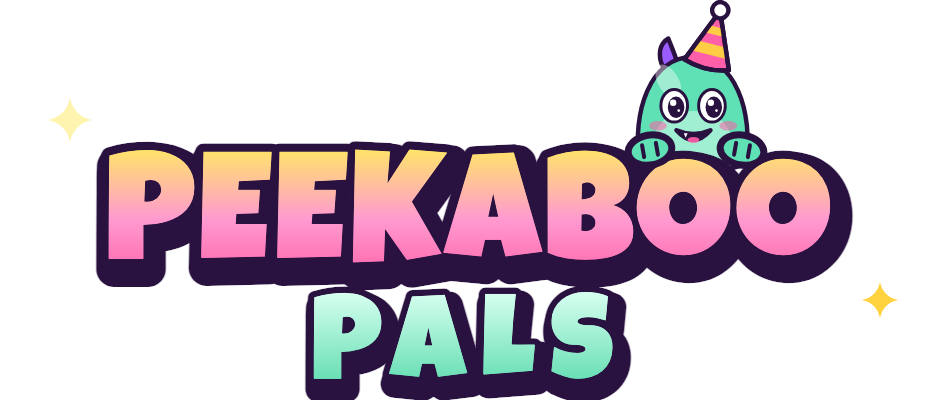
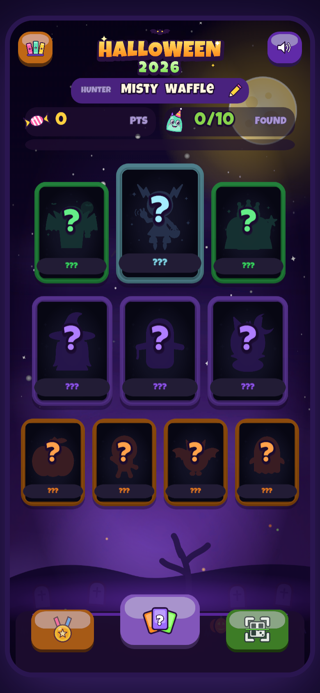
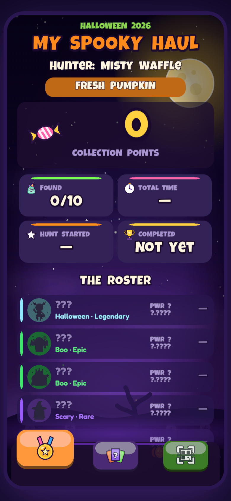
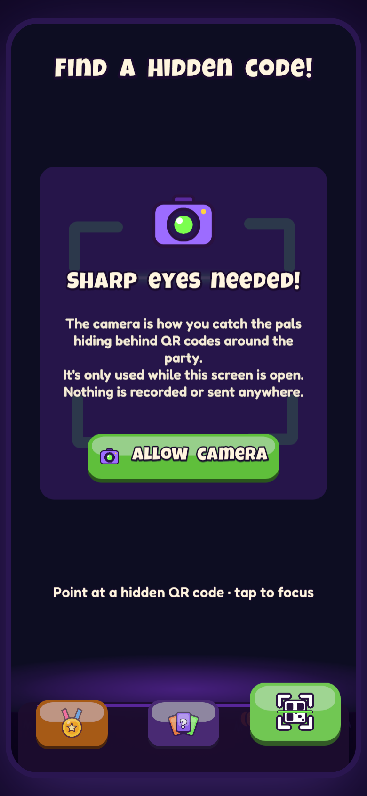
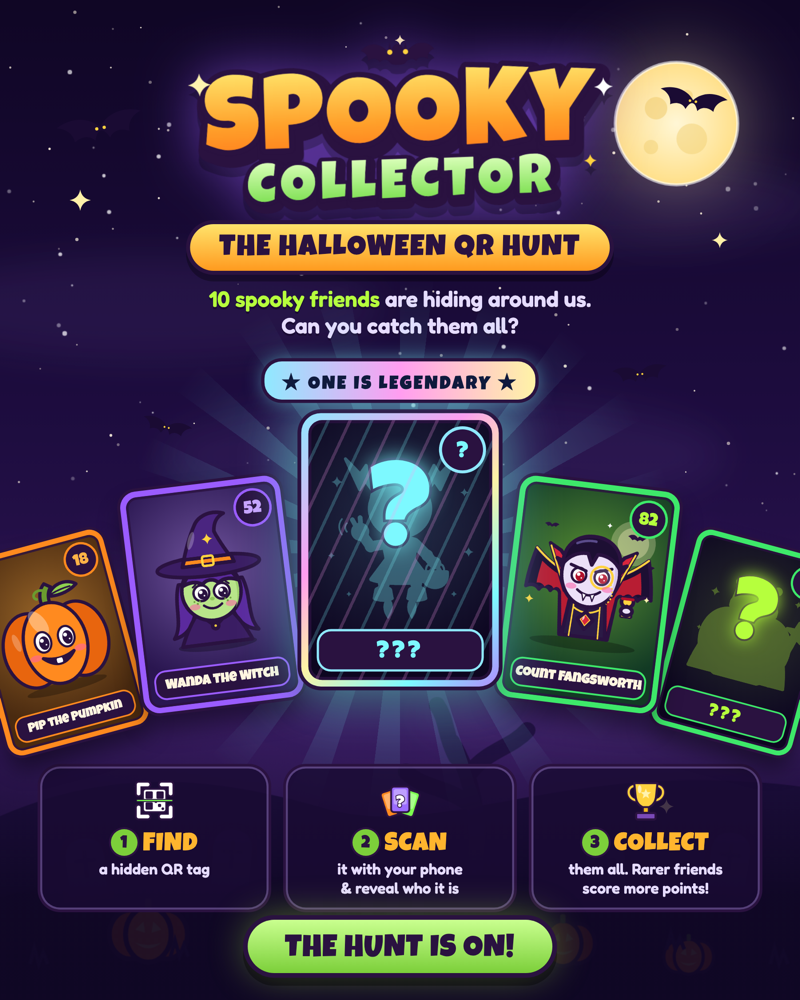

<p align="center">
  
</p>

<p align="center">
  <b>A real-world party scavenger hunt.</b><br>
  Hide QR codes around the party, scan them with your phone, collect the pals.
</p>

<p align="center">
  <a href="https://guileless-dusk-fc1546.netlify.app/"></a>
</p>

<p align="center">
  
  
  
  
  
</p>

---

Every QR tag hidden around the party unlocks exactly one **pal** in one of four rarity tiers. Each catch rolls a
CS-skin-style **float** that grades the catch and adds bonus points, so a second scan can still be an upgrade. At the end
of the night everyone compares their Results screen. Each party is its own **collection**: Halloween 2026 was the first,
and new collections reach every installed app over the air without a new build.

No backend, no accounts, no tracking. Progress lives on the phone.

## Play it

| | |
|---|---|
| **Browser (iPhone and desktop)** | **https://guileless-dusk-fc1546.netlify.app/** — open on a phone, allow the camera, then *Share → Add to Home Screen* for full screen. |
| **Android** | Native APK (ZXing camera scanner, haptics, autofocus). The party build was handed out via a download poster; build your own from the editor, see below. |

The live build is the **Halloween 2026** collection. Without the party's printed tags there is nothing to scan, but the
collection, Results screen, nickname roll and host tools (long-press the logo) all work.

## Screenshots

<p align="center">
  &nbsp;
  &nbsp;
  
</p>

<p align="center">
  <br>
  <sub>The poster that hung at the party (printed from <code>Tools/print/promo.py</code>).</sub>
</p>

## Highlights

- **Rarity and floats.** Four tiers (Spooky, Scary, Boo, Halloween in the first pack) and six float grades from
  *Phantom Perfect* to *Crumbly Old*. Rarer floats get saturated, metallic card art; low grades turn pale and scratched
  (`Shaders/UiWear.shader`). Reveals scale with rarity: build-up, particles, screen shake, haptics and a stinger.
- **Re-catching done right.** A tag can be scanned again after a cooldown. A better float gives an *UPGRADE!* reveal
  and only the difference in bonus points, so the score can't be farmed.
- **Collections as data.** A party is a folder in `Packs/` (`pack.json`, art, voices, QR secrets). Unity validates and
  ships it, the website carries the same folder, and installed apps download new collections on launch. Only hashes of
  the QR secrets ship, so codes can't be read out of the app or the site. See [PACKS.md](PACKS.md).
- **Two scanners.** Native builds decode with ZXing.Net off the main thread. The WebGL build streams camera frames to
  **jsQR in a Web Worker**, because browsers give Unity no threads. Scanning a tag with the phone camera opens the web
  app with the code already in the URL.
- **Everything generated.** All art is drawn as SVG in Python and rendered to PNG (`Tools/art`), every sound and the
  lobby music are synthesized from scratch with numpy (`Tools/audio`), and the UI is built in code. Print materials
  (QR sheets, download posters, voting cards) come from `Tools/print`. Third-party assets are in [CREDITS.md](CREDITS.md).
- **Architecture.** Arch ECS with request/event components, VContainer composition root, a small tween engine and a
  one-draw-call particle system. It grew out of an ECS template that is documented in the second half of this file.

## Repository map

```
Assets/_Main/Scripts/   game code: Ecs/ (gameplay systems), Services/ (QR, packs, floats, audio…), Ui/, Fx/, Editor/
Assets/_Main/Art, Audio generated assets (regenerate with Tools/)
Packs/                  collections: halloween-2026/ and _template/, plus site.json for the website
Tools/                  art, audio, print and web helper scripts (Python)
PACKS.md                how to make and deliver a new collection
CREDITS.md              every third-party asset and license
```

> **Note on Jenny XJ-Boo.** The legendary pal is a fan tribute to Jenny Wakeman from *My Life as a Teenage Robot*. The
> drawing is original, but the character concept belongs to its owners. It was fine for a free private party game and
> should be replaced before any commercial use. Details in [CREDITS.md](CREDITS.md).

---

# Developer guide

It's built on this repo's ECSTemplate (Arch ECS + VContainer). The template reference is further down.

## Quick start (editor)

1. Open the project in **Unity 6000.3.9f1**.
2. Run **Party > Build Game Scene**. It imports TMP Essentials, configures importers, creates the configs and
   writes `Assets/Scenes/SpookyCollector.unity`. It's safe to re-run: existing configs keep their edits.
3. Open `Assets/Scenes/SpookyCollector.unity` and press **Play**. There's no webcam in the editor, so on the
   **Scan** tab tap **Type code**. You can type a payload or simulate any character's scan, or a fake one.

Headless (CI / no editor window):

```bash
U=/Applications/Unity/Hub/Editor/6000.3.9f1/Unity.app/Contents/MacOS/Unity
$U -batchmode -projectPath . -executeMethod _Main.Scripts.Editor.SpookyProjectBuilder.BatchImportTmpEssentials   # once
$U -batchmode -quit -projectPath . -executeMethod _Main.Scripts.Editor.SpookyProjectBuilder.BuildAll
$U -batchmode -quit -projectPath . -buildTarget Android -executeMethod _Main.Scripts.Editor.SpookyDevBuilds.BuildAndroid
```

## Floats, re-catching and nicknames

- **Float:** every catch rolls a float in [0, 1), CS-skin style. Lower is rarer. A configurable table of **float
  grades** (best first: Phantom Perfect, Freshly Haunted, Lightly Cursed, Well Spooked, Cobwebbed, Crumbly Old)
  sets each grade's chance (weight), its range and its **bonus points**. Inside a grade the float is uniform.
- **Score per character** = tier points + the bonus of its **best** float. The completion bonus comes on top.
- **Re-catching:** a character can be scanned again after `Recatch Cooldown Seconds` (default 180). A new float
  that beats the best one gives an "UPGRADE!" reveal and only the *difference* in bonus, so the score can't be
  farmed. A worse float still gets a little roll animation. Scanning before the cooldown ends shows a calm
  "resting, back in m:ss" popup.
- **Look:** the float reveal rolls the number down like a slot machine, then the grade slams in and the chip
  catches fire, scaled by the grade's flame intensity. The top grade adds a flash, shake and ring of fire. Cards
  carry a float chip. Rare floats get saturated, contrasty art (`Shaders/UiWear.shader`) and a metallic frame; low
  grades turn pale and scratched. Every grade's look is set in the config.
- **Nickname:** shown under the logo, generated on first launch. Tap it to type a new one or roll one with the 🎲.
  It's shown on the Results screen and survives "Reset progress".

## Testing on a real phone

- Build with **Party > Build Android APK**, which writes `Builds/Android/SpookyCollector.apk`. You can also use
  File > Build Profiles with the scene already in the list. Install it with `adb install -r Builds/Android/SpookyCollector.apk`.
- **Camera:** this is a native app, so the browser HTTPS/localhost rule doesn't apply. Opening the Scan tab first
  explains why the camera is needed, then shows the Android permission prompt. If the player denies it, they can
  try again. If they chose "Don't ask again", the game offers a button that opens the app's settings.
- Hold codes about 20–40 cm from the camera and avoid glare on glossy paper. Codes shown on another phone's
  screen usually scan too, which is handy for testing (see Host tools).
- Development builds keep the **Type code** button for testing. Release builds hide it.

## iPhone and browsers (WebGL)

The Android APK stays the main build. For iPhone users there's a WebGL build: one HTTPS link, no App Store, no
TestFlight.

- **Build:** run **Party > Build WebGL (iPhone + browsers)**. It writes `Builds/WebGL/`, about 24 MB, and uses the
  `Assets/WebGLTemplates/Spooky` page (full-screen portrait, themed loader, Add-to-Home-Screen icon). Headless:
  `$U -batchmode -quit -projectPath . -buildTarget WebGL -executeMethod _Main.Scripts.Editor.SpookyDevBuilds.BuildWebGL`.
  Run the Android build afterwards (or switch the platform back) so the editor stays on Android.
- **Host it over HTTPS:** browsers only allow the camera on HTTPS or localhost. The build uses Gzip with
  decompression fallback, so any static host works without server configuration:
  - **Netlify Drop:** drag the `Builds/WebGL` folder onto https://app.netlify.com/drop and you get an HTTPS link in seconds.
  - **itch.io:** zip the *contents* of `Builds/WebGL`, upload it as an HTML game and tick "mobile friendly".
  - **GitHub Pages** also works.
- **QR decoding:** browsers give Unity no threads, so frames go to **jsQR running in a Web Worker**
  (`Assets/Plugins/WebGL/SpookyWeb.jslib` + `SpookyJsQR.jspre`; regenerate the latter with
  `Tools/web/build_jsqr_jspre.py`). The page never blocks while decoding.
- **Tips to send iPhone friends:**
  - Open the link in Safari, then **Share > Add to Home Screen**. The game opens full screen, and Safari is less
    likely to clear the saved hunt (it may wipe website data after about 7 days without visits).
  - Allow the camera when asked. If it was blocked: tap **aA** in the address bar, then Website Settings, Camera, Allow, and reload.
  - There's no vibration on iPhone browsers (Safari doesn't support it). Sound starts after the first tap.
- **Testing on a laptop:** browsers treat `localhost` as secure, so you can serve `Builds/WebGL` locally (for
  example `python3 -m http.server` inside it) and open http://localhost:8000. To test on a phone, use one of the HTTPS hosts above.

## Collections, QR codes and printing

Characters, art, voices and QR secrets live in collection packs under `Packs/` (one folder per party), not in
Unity assets. **[PACKS.md](PACKS.md)** covers everything: the folder format, `pack.json`, building
(**Party > Packs > Build Packs**, also run automatically before every player build), printing
(**Party > Packs > Export QR Sheets** → `QRSheet/<pack>/index.html`), verifying (**Party > Packs > Verify QR Codes**) and
delivering the update. Payloads are links (`https://<site>/?c=<pack>.<id>.<SECRET>`); the Halloween 2026 tags
(`SPOOKY:<id>:<SECRET>`) keep working. Only hashes of the secrets ship; the secrets stay in `Packs/<pack>/codes.json`.

## Host tools and reset

**Long-press the collection logo** on the home screen for about 1.3 s. The host tools have:
- what's in the collection on screen,
- Sound, Vibration and Reduced-motion toggles,
- **Reset this collection** (wipes that collection only) and **Erase everything** (every collection), each with a
  confirmation step. Settings and the nickname stay.

## Game rules and balance

`Assets/_Main/Configs/CollectionConfig.asset` holds the rules every collection shares:
- **Rarity tiers:** default names, points, colors, number of stars, reveal style, build-up length, particle count,
  screen shake, haptics and stinger sound. Packs can rename and recolor tiers, but not change points.
- **Float:** the re-catch cooldown and the float grades (name, max float, weight, bonus points, color, metallic,
  saturation, contrast, wash, scratches, flame intensity and colors). Packs can rename grades.
- The completion bonus (+100).

The UI has no character-specific code. When you rebalance points, saved progress is re-scored the next time the
app starts. **Party > Reset Game Rules To Defaults** restores the shipped tiers and grades.

Sounds are mapped in `AudioConfig.asset` and UI sprites, fonts and colors in `UiThemeConfig.asset`. To regenerate the
original art (app + Halloween pack) run `python3 Tools/art/build.py`, and for the synthesized audio run
`python3 Tools/audio/synth.py`. Third-party assets are listed in `CREDITS.md`.

## How the game maps onto the template

| Concern | Where |
|---|---|
| Data | Collections: `Packs/` → `Editor/PackBuilder` → `StreamingAssets/Packs` (+ the same folder on the website) → `Services/Packs/PackLibrary` (UnityWebRequest, so APK / editor / web / downloads all load the same way; `PackCache` downloads and verifies new packs into persistentDataPath, see PACKS.md) → `CollectionPack : ICollectionPack`. Shared rules: `Configs/Collection/CollectionConfig` (`ICollectionRules`); `Configs/Audio`, `Configs/Ui` |
| Gameplay | `Ecs/Collection`: `ScanQrCodeReq` → `ProcessQrScanSys` (resolves pack + character; new / resting / float upgrade / no improvement / invalid, rolls the float via `Services/Floats`, awards `UpdateScoreReq`) → `CheckCollectionCompletionSys` (per-pack bonus + completion time) → `ResetCollectionSys` → `PublishCollectionStateSys` (`AlbumSnapshot` of every pack for the UI) |
| Persistence | Template save path. `GameSaveData.Packs` holds, per pack and character, the first and last catch times, the catch count and the best float, plus each pack's first-scan and completion times. Progress of packs the build doesn't have is kept. The pre-pack `GameSaveData.Collection` is migrated into `halloween-2026` on load. Settings, including the nickname and the last viewed pack, use their own PlayerPrefs key |
| Session model | One endless session holds every collection. `CheckSessionTimeoutSys` isn't registered and the combo is off (min = max = 1). The score is the lifetime total; each collection's points are derived. "Erase everything" is `EndGameSessionReq(ForcefullyEndedByUser)`, which clears the save, and then `SpookyGameManager` starts a new session |
| QR | `Services/Qr`: payload codec (links, typed `pack.id.SECRET`, legacy `SPOOKY:`), resolver (hash check via `Services/Packs/PackCodes`), ZXing camera scanner (decodes off the main thread), the WebGL camera + jsQR worker, QR image generator. The web build also catches a code in its own URL (tag scanned with the phone camera) |
| Audio / haptics / settings / camera permission | `Services/Audio`, `Services/Haptics`, `Services/Settings`, `Services/Permissions` |
| FX | `Fx/Tweening` (small tween engine), `Fx/Particles` (one-draw-call mesh particle system + presets), `Fx/ScreenEffects` |
| UI | `Ui/UiRoot` builds the canvas in code once the packs are loaded and rebuilds the per-collection screens on a switch; `Ui/Screens` (lobby, results, scanner, host, album shelf), `Ui/Popups`, `Ui/Flow` (splash, rarity-scaled reveal, completion), `Ui/Widgets` (the ambient sky follows the pack theme) |

Debug only: a macOS development player with an autopilot (define `SPOOKY_AUTOPILOT`, see `Ui/Debug/Autopilot.cs`
and `Editor/SpookyDevBuilds.cs`) plays the whole flow and saves screenshots. It was used to check the UI without a device.

---

# Template reference (ECSTemplate)

> The template's `TemplateGameManager` / `TemplateSceneInstaller` were renamed to `SpookyGameManager` /
> `SpookySceneInstaller` for this game, as the template recommends. Everything below describes the template itself.


A template Unity project for building new games on **ECS (Arch)** + **VContainer**, mirroring the
Mahjong project's architecture while staying **completely decoupled from `_PapayaKit`**. Copy this
project (or use it as a reference) when starting a new game.

- Unity: `6000.3.9f1` (same as the rest of the monorepo)
- ECS: [Arch](https://github.com/genaray/Arch) `2.1.0` (vendored under `Assets/_Main/NuGet/`, managed by NuGetForUnity)
- DI: [VContainer](https://vcontainer.hadashikick.jp/) `1.17.0` (UPM, OpenUPM registry)
- JSON: Newtonsoft (`com.unity.nuget.newtonsoft-json`)
- Result types: [OneOf](https://github.com/mcintyre321/OneOf) (vendored)
- Nullable reference types are enabled repo-style via `Assets/csc.rsp`; C# uses tabs.

## Layout

```
Assets/_Main/Scripts/
├── TemplateGameManager.cs        ← scene entry point: starts/stops sessions, ticks the ECS world
├── TemplateSceneInstaller.cs     ← composition root (LifetimeScope): configs, services, system order
├── Configs/                      ← ScriptableObject configs exposed to DI as interfaces
│   ├── Time/                     (session duration, save interval, pause budget)
│   └── Scoring/                  (combo multiplier range + decay tiers)
├── Services/
│   ├── Time/                     ← GameplayTimeService: pause budget, session clock, save-restore shift
│   └── Events/                   ← event-bus event structs (time/score/session lifecycle)
├── Ecs/
│   ├── EcsRuntime.cs             ← world lifecycle: bake → init → tick → dispose → clear
│   ├── Time/                     ← gameplay timer feature (Cmp + Sys)
│   ├── Scoring/                  ← generic scoring + combo feature (Cmp + Sys)
│   ├── GameSaving/               ← periodic + on-demand session save (Cmp + Data + Sys)
│   ├── SessionStarting/          ← singleton creation + new-session/restore bootstrapping
│   └── SessionEnding/            ← end-reason handling + scene close request
└── _ProjectAgnostic/             ← infrastructure you should rarely need to touch
    ├── Ecs/BetterArchApi/        ← SCommandBuffer, safe/singleton World extensions, DI registration helpers
    ├── Ecs/UnityIntegration/     ← system interfaces + pipeline, MonoBehaviour → entity baking
    ├── Ecs/CommonSystems/        ← DestroyEmptyEntitiesSys
    ├── Ecs/AppLifecycle/         ← OS background/foreground → ECS events
    ├── Services/                 ← event bus, input, UI raycast
    ├── Providers/                ← JSON serialization, persistent storage (PlayerPrefs), time providers
    ├── GameplaySessionLifetime/  ← per-session GameObject hierarchy create/dispose
    └── Utils/
```

Namespaces follow the Mahjong convention (`_Main.Scripts...`), so porting code/improvements between
Mahjong and games built from this template is a straight copy.

## Core flow

1. `TemplateSceneInstaller` (a VContainer `LifetimeScope`) registers everything. **The registration
   order of `RegisterEcsSystem<T>()` calls IS the per-tick execution order.**
2. `TemplateGameManager.StartSession(restore)` instantiates the session prefab (through the container,
   so `[Inject]` components in it are injected), then `EcsRuntime.Start()`:
   - bakes every registered `BaseEcsMonoBaker` into the world (MonoBehaviour → entity),
   - fires `IEcsInitSystem`s (`InitializeSessionSys` creates the singleton components,
     `StartSessionSys` restores the save or records a fresh session start).
3. Every `Update` the manager calls `EcsRuntime.Tick()` → all `IEcsTickSystem`s run in order.
4. Systems communicate via short-lived request/event **components** (`XxxReq` / `OnXxxEvt`) and talk
   to the UI/meta layer via the **event bus** (`IGameplayEventBusService`, `OnXxxEvent` structs).
5. An `EndGameSessionReq` (from your win-condition system, the timeout check, or the user quitting)
   ends the session: save cleared, `OnGameSessionEndedEvent` published, scene close requested, and
   the manager stops the runtime and disposes the session objects on the next frame.

### Built-in project-agnostic features

| Feature | What it gives you |
| --- | --- |
| Timer (`Ecs/Time`) | Server-time-authoritative session clock, pause/resume with a limited pause budget, timeout → session end |
| Scoring (`Ecs/Scoring`) | `UpdateScoreReq { Gain / Penalty / Restore }`, combo multiplier with configurable decay tiers that survives pauses/restores |
| Saving (`Ecs/GameSaving`) | Periodic + event-driven session snapshot to persistent storage (PlayerPrefs by default) |
| Session lifecycle | Restore-from-save on start, clean end with a typed `EndGameReason` |
| App lifecycle | Background → pause + synchronous save flush (iOS-safe), foreground → your call |
| Input | Lockable tap/finger position service feeding input events into the world |

## Scene setup (one-time, the project ships without a wired scene)

1. In your gameplay scene create a `Scope` GameObject and add **TemplateSceneInstaller**.
2. Create a `GameManager` GameObject with **TemplateGameManager**; assign it on the installer.
3. Add a **GameplaySessionObjectFactory** component (e.g. on the `Scope` object); assign:
   - *Gameplay Object Parent* — a scene transform the session hierarchy is parented under,
   - *Gameplay Object Prefab* — your session root prefab (board, spawners, bakers, session-scoped UI).
   Assign the factory on the installer.
4. Create the config assets via `Assets > Create > Configs > TimeConfig / ScoringConfig` and assign
   them on the installer.
5. Press Play. With `Auto Start Session On Start` enabled the manager starts (or restores) a session
   immediately. In the editor, press **P** to simulate the app being backgrounded (pause + save).

Notes:
- Anything with `[Inject]` that lives in the **session prefab** is injected automatically (it is
  instantiated through the container). Scene-placed injectables (including scene-placed bakers) must
  be listed in the LifetimeScope's **Auto Inject Game Objects**.
- The event bus intentionally logs an error when an event has no subscribers — wire your UI to
  `OnTimeUpdatedEvent` / `OnScoreUpdatedEvent` / combo events, or remove the placeholder handlers in
  `TemplateGameManager` once you have real ones.

## Expanding the template into a game

Adding a gameplay feature (the Mahjong pattern):

1. Create `Ecs/<Feature>/Cmp/` with plain-struct components: state (`XxxCmp` / singleton `XxxSinglCmp`),
   requests (`XxxReq`), events (`OnXxxEvt`).
2. Create `Ecs/<Feature>/Sys/` with systems implementing `IEcsInitSystem` / `IEcsTickSystem` /
   `IEcsDisposeSystem`. Inject `World`, services, and configs through the constructor. Consume your
   request components, then remove them via `SCommandBuffer` in the same tick.
3. Register the systems in `TemplateSceneInstaller.InstallEcs` **at the right point in the order**
   (markers show where board generation and gameplay systems belong).
4. To bring scene/prefab data into the world, subclass `BaseEcsMonoBaker` and override
   `OnBake(World, Entity)`; put the baker in the session prefab.
5. Configs: `ScriptableObject` + interface, registered in `InstallConfigs`; services: interface + impl
   registered in `InstallServices`.
6. Extend `GameSaveData` (plus `SaveGameStateSys` / `StartSessionSys`) when the feature has state that
   must survive an app kill.

Renaming for a new game: duplicate the project folder, rename `TemplateGameManager` /
`TemplateSceneInstaller` (e.g. `MyGameManager` / `MyGameSceneInstaller`), and set the product name in
`ProjectSettings`. Namespaces can stay `_Main.Scripts...`.

## Tests

Core infrastructure tests live in `Assets/_Main/Scripts/Editor/Tests` (EditMode, plain NUnit):
command buffer, systems pipeline, baking service, event bus, empty-entity cleanup. Run them via
`Window > General > Test Runner` and extend them alongside your gameplay systems.

## Managing native/NuGet dependencies

Arch and OneOf are plain DLLs vendored under `Assets/_Main/NuGet/` and tracked in
`Assets/_Main/packages.config`; use **NuGetForUnity** (`NuGet > Manage NuGet Packages`) to update
them. UPM dependencies (VContainer, Newtonsoft) live in `Packages/manifest.json` with the OpenUPM
scoped registry already configured.

## License

Code is released under the [MIT License](LICENSE). Art, music and sounds made for this project are CC0, and
third-party assets keep their own licenses, all listed in [CREDITS.md](CREDITS.md).
